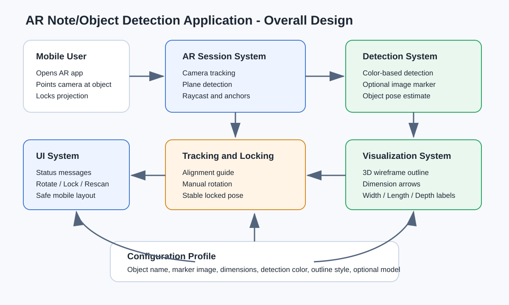
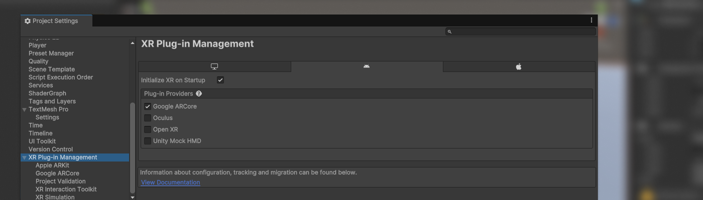

# Overall Design Document: AR Note/Object Detection Application

## 1. Application Overview

The application is a mobile Augmented Reality app built in Unity. Its purpose is to detect a real-world note/notebook/object placed on a table and display a correctly scaled 3D outline with dimension labels over it.

The app helps the user visually align a digital CAD-style projection with a physical object using the phone camera. Once aligned, the user can lock the projection in place and view the object's Length, Width, and Depth directly in AR.

*Reference image used by the application for note/object setup and detection.*

## 2. Application Purpose

The main purpose of the application is to provide an AR-based object visualization and measurement reference system.

Instead of manually comparing a physical object with drawings or dimensions, the user can open the app, scan the object, align the virtual outline, and view a projected 3D reference directly on top of the real object.

## 3. Target Users

- Students or engineers checking physical notebooks, samples, or small objects.
- CAD/demo users who want to visualize dimensions in AR.
- Operators who need a simple AR guide for aligning a real object with a reference outline.
- Demonstration users for AR object detection and projection workflows.

## 4. Core Features

- Mobile AR camera view.
- Horizontal surface detection.
- Object/note detection using cover color.
- Optional image-marker detection if the object image is suitable.
- Manual alignment using a green AR guide box.
- Rotate-left and rotate-right controls for orientation adjustment.
- Lock button to fix the AR projection on the object.
- Rescan button to restart detection.
- 3D wireframe outline matching configured real-world dimensions.
- Dimension labels for Width, Length, and Depth.
- Safe mobile UI that fits around notches and navigation bars.
- Unity Editor setup tool for configuring object image, dimensions, and visual style.
- Android APK build support.

## 5. High-Level User Flow

1. User opens the mobile AR app.
2. The camera starts and the app begins detecting flat table surfaces.
3. The user points the camera toward the physical note/object.
4. The app tries to detect the object automatically using its cover color.
5. If automatic detection succeeds, the green guide box snaps to the object.
6. If detection is not perfect, the user manually aligns the guide using phone movement and rotate buttons.
7. The user taps `LOCK & INSPECT`.
8. The app anchors the virtual outline in the real world.
9. The app displays the 3D outline and dimension labels over the object.
10. The user can tap `RESCAN NOTE` to clear the projection and scan again.
11. The user can tap `EXIT` to close the application.

## 6. Main Screens and UI

### 6.1 AR Camera Screen

This is the main screen of the application. The live camera feed fills the background. AR objects and UI controls appear over the camera view.

Main elements:

- Status message.
- Target/model name display.
- Distance guidance.
- Green alignment box.
- Rotate left button.
- Rotate right button.
- Lock / Rescan button.
- Exit button.

### 6.2 Alignment State

Before locking, the app shows a green 3D guide box. This box represents the expected size of the physical object.

The user can:

- Move the phone to scan the table.
- Aim at the object.
- Let the app auto-detect the object by color.
- Rotate the guide if the direction is wrong.
- Lock the guide when it matches the object.

### 6.3 Locked Projection State

After locking, the app hides the alignment controls that are no longer needed and displays:

- A fixed 3D outline.
- Width label.
- Length label.
- Depth label.
- Dimension arrows and callouts.
- Rescan option.

## 7. System Architecture

The application is divided into five main systems:

1. AR Session System
2. Detection System
3. Tracking and Locking System
4. Visualization System
5. UI System

## 8. AR Session System

The AR Session System manages the mobile AR environment.

Responsibilities:

- Start and maintain the AR camera session.
- Detect horizontal planes such as tables.
- Perform AR raycasts from screen positions into the real world.
- Create AR anchors when the user locks the object.
- Reset the AR session when needed.

This system is built on Unity AR Foundation, ARCore, ARKit, and XR Management.

## 9. Detection System

The Detection System helps locate the physical object in the camera view.

The app supports two detection approaches.

### 9.1 Color-Based Detection

The app analyzes the camera image and searches for the configured cover/object color.

Process:

1. Capture a small version of the camera image.
2. Convert pixels into color/hue information.
3. Find the largest region matching the configured object color.
4. Check whether the detected region looks rectangular.
5. Estimate the object's center, corners, and orientation.
6. Convert the 2D screen detection into a 3D AR pose on the table.

This is useful when the object has a clear colored cover but does not have enough visual detail for image-marker tracking.

### 9.2 Image Marker Detection

If the selected object image is good enough for ARCore image tracking, the app can use it as a tracked marker.

When the camera recognizes the image, the app can automatically lock the outline to the tracked image position.

If the image is too plain or low-detail, this mode is disabled and the app uses color detection plus manual alignment instead.

## 10. Tracking and Locking System

The Tracking and Locking System decides where the virtual object should appear.

Before locking:

- The guide follows the detected object if available.
- Otherwise it follows the detected table plane.
- The user can rotate the guide.
- The user can tap the surface to reposition.

After locking:

- The app creates an AR anchor when possible.
- If an AR anchor cannot be created, the app uses a fixed world-space object as fallback.
- The outline remains stable instead of constantly moving with small detection noise.
- Large confirmed drift can be corrected smoothly.

## 11. Visualization System

The Visualization System creates the AR projection shown to the user.

*AR camera experience style used as the base for the mobile application.*

It generates:

- 3D wireframe box.
- Corner nodes.
- Dimension arrows.
- Width label.
- Length label.
- Depth label.
- Optional dark label background plates.
- Optional 3D model inside the outline.

The visualization is generated at runtime from the configured dimensions. This means the same app can support different object sizes without creating a separate prefab for each one.

Coordinate design:

- X axis = Width.
- Y axis = Depth / Thickness.
- Z axis = Length.

## 12. UI System

The UI System provides the mobile controls and status messages.

Responsibilities:

- Show whether the app is scanning, aligned, or locked.
- Show target object name and dimensions.
- Show distance guidance.
- Enable or disable the lock button depending on tracking state.
- Provide rotate controls before locking.
- Switch the main action button between `LOCK & INSPECT` and `RESCAN NOTE`.
- Provide an exit button.
- Fit the interface within the phone safe area.

## 13. Configuration System

The application uses a profile-based configuration system.

The profile stores:

- Object/model name.
- Marker image.
- Reference image library.
- Length in millimeters.
- Width in millimeters.
- Thickness/depth in millimeters.
- Detection color.
- Color tolerance.
- Outline color.
- Line thickness.
- Dimension label style.
- Optional 3D model prefab.

This allows the app to be changed for a different note/object without rewriting the runtime code.

## 14. Editor Tool Design

The Unity Editor includes a setup tool for preparing the app.

The setup tool allows the developer to:

- Select or import the object image.
- Enter real-world dimensions.
- Choose outline color and label style.
- Detect the dominant cover color from the image.
- Check whether the image is suitable for ARCore image tracking.
- Apply the configuration to the AR scene.
- Prepare the scene for Android build.

This reduces manual scene setup and helps avoid build errors.

## 15. Build Design

The application is designed mainly for Android AR devices.

Build characteristics:

- Platform: Android.
- AR provider: ARCore.
- Minimum Android SDK: 26.
- Target Android SDK: 34.
- Rendering pipeline: Universal Render Pipeline.
- Scripting backend: IL2CPP.

The project also includes ARKit configuration, so iOS support is possible, but the current active build flow is Android.

## 16. Data Flow

The main runtime data flow is:

1. Camera image and AR tracking data enter through AR Foundation.
2. Plane detection finds real-world surfaces.
3. Color or image detection estimates object position.
4. Tracker converts detection into a stable AR pose.
5. User confirms by pressing Lock.
6. Anchor is created.
7. Visualization system renders outline and dimensions at the locked pose.
8. UI updates based on locked/scanning state.

## 17. Application Modules

| Module | Purpose |
|---|---|
| AR Session | Starts and manages AR tracking |
| Plane Detection | Detects table/surface |
| Object Detection | Finds object by color or image marker |
| Tracker | Maintains alignment, lock, rescan, and anchor state |
| Renderer | Creates 3D outline and dimension callouts |
| HUD | Shows controls and status |
| Profile | Stores object dimensions and visual settings |
| Editor Tool | Configures profile and scene |
| Build Helper | Prepares and builds Android APK |

## 18. Current Application State

Current configured object:

- Name: `Note`
- Length: `240 mm`
- Width: `180 mm`
- Thickness: `6 mm`
- Auto-detect by color: enabled
- Main scene: `AR_Detection`
- Main platform: Android

Current behavior:

- The app is primarily set up for color-based note detection and manual Align and Lock.
- Image tracking is optional and depends on marker-image quality.
- The app displays a green CAD-style wireframe projection with dimension callouts.

## 19. Limitations

- Detection quality depends on lighting conditions.
- Color detection works best when the object color is different from the table/background.
- Plain covers may not work well as image markers.
- The app needs a detectable flat surface for reliable locking.
- Current system visualizes dimensions but does not perform automated pass/fail inspection.
- Current system does not save inspection history or reports.

## 20. Future Enhancements

- Add support for multiple object profiles.
- Add object profile selection inside the mobile app.
- Add saved scan history.
- Add measurement comparison against expected CAD dimensions.
- Add pass/fail inspection mode.
- Add support for importing real CAD models.
- Add better object segmentation beyond color detection.
- Add cloud or local report export.
- Add calibration workflow for improved accuracy.
- Add iOS build validation.

